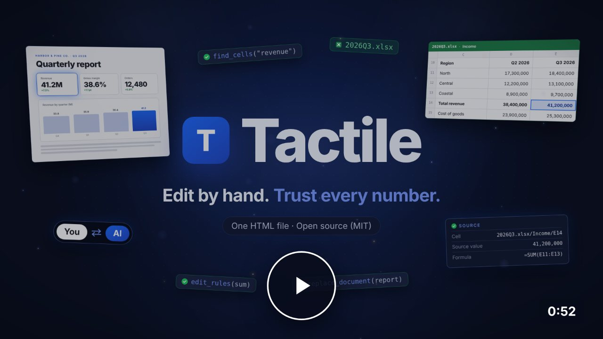
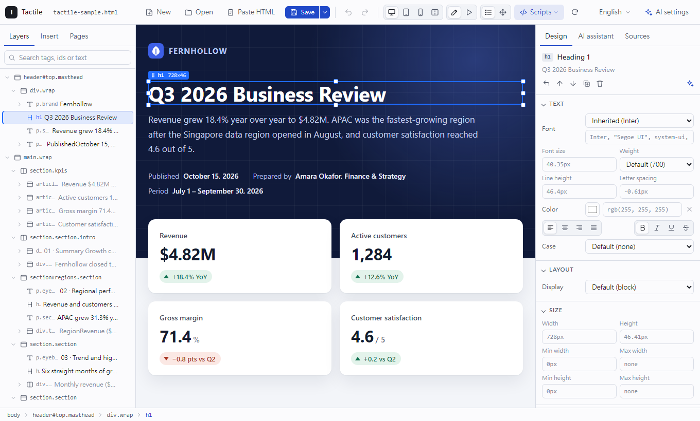
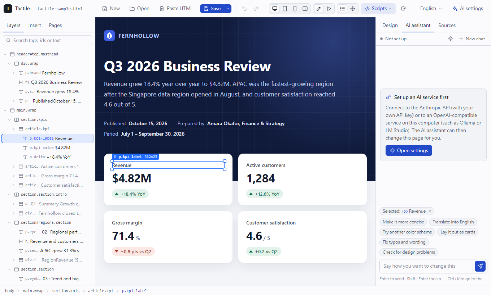
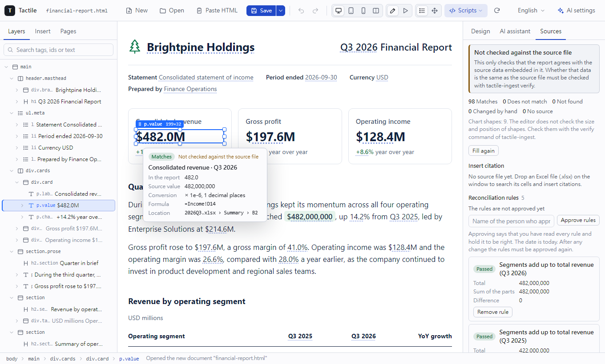
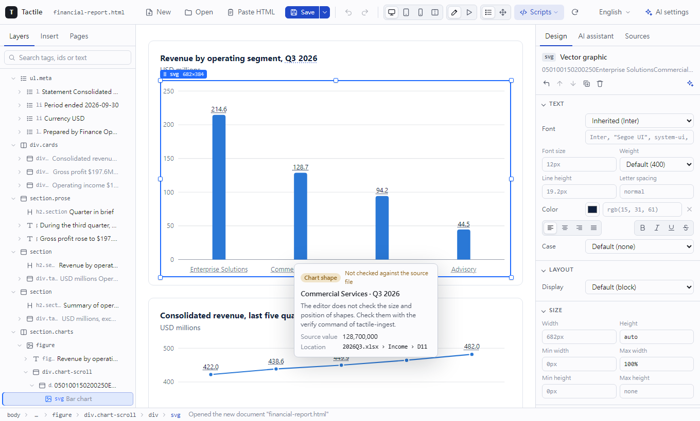
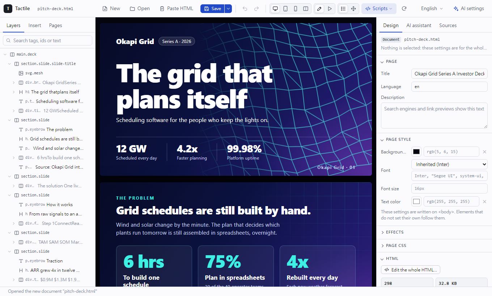
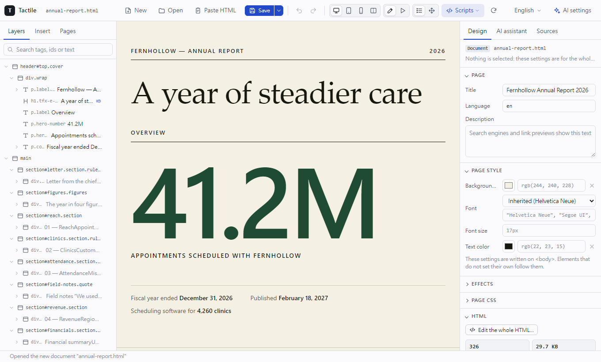
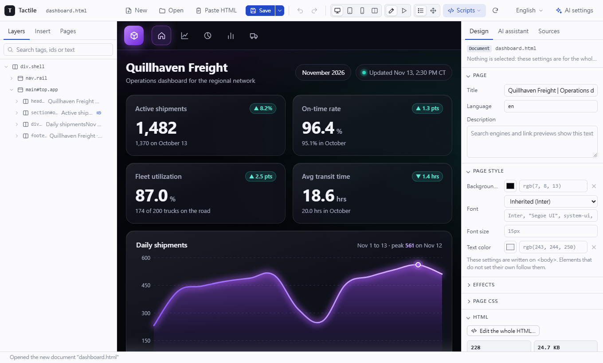
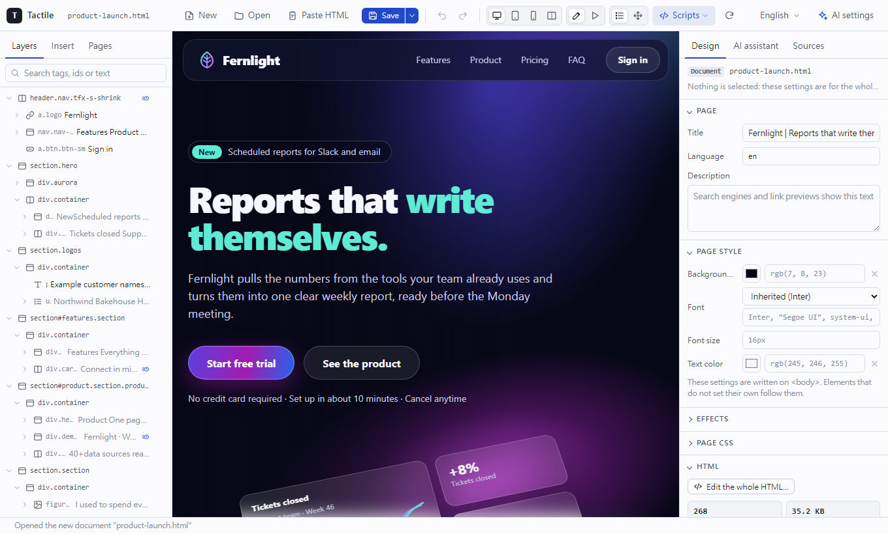

# Tactile HTML editor

[繁體中文](README.zh-TW.md)

**You and an AI, working in one HTML file.** Edit a page by hand the way you edit a slide: click to select, double-click to type, drag to move. Ask the built-in assistant for the rest. When a report is built from a spreadsheet, the AI never types a number: it names the cell, and the editor writes the value.

One HTML file, no install, no server. Open source (MIT).

**[Try it in your browser](https://lin830326.github.io/tactile-html-editor/)**: the same file, served as a page. Nothing you open there leaves your computer unless you turn the assistant on.

[](docs/media/tactile-promo.mp4)

*The film (52 seconds, with sound): [docs/media/tactile-promo.mp4](docs/media/tactile-promo.mp4). The company and the figures in it are made up.*

## Why

Reports, slide decks and landing pages are now often written by an AI as HTML.

- **Changing one word should not need another prompt.** Open the file the AI wrote, fix what you see, press `Ctrl+S`. The change goes back into the same file.
- **A number an AI copied can be wrong, and nobody can tell by looking.** Here every number in a report links to the spreadsheet cell it came from. Click it to see the cell, the source value and the formula.
- **You stay in charge.** The assistant can draft a reconciliation rule; only you can approve one. One AI edit is one undo step.

## Quick start

Download [`dist/tactile.html`](dist/tactile.html) and open it in a browser. That is all. Or open the [demo page](https://lin830326.github.io/tactile-html-editor/) and download nothing.

To try it on a page of your own: press **Open** and choose an HTML file, or drop the file on the window. To try a traceable report: press **New** and pick *Report: Traceable financial report*, then click any number.

The interface is in English, Traditional Chinese and Simplified Chinese. It follows the browser's language, and the button in the top right corner switches.

## What it looks like

**Edit by hand.** Layers on the left, the page in the middle, properties on the right.



**Ask the assistant.** Select an element, then say what you want changed. It works with tools on the page you see, and every run is one undo step.



**Trace a number.** Click a figure to see the spreadsheet cell it comes from, its source value and its formula. The Sources panel lists every number's state and the reconciliation rules.



**Charts drawn from cells.** A bar knows its cell too.



**Start from a template.** Twelve in English, more in Traditional and Simplified Chinese. Four of them:

| | |
|---|---|
|  Investor pitch deck |  Annual report |
|  Analytics dashboard |  Product launch page |

## You and an AI agent, one file

An AI agent writes `report.html`. You open that file in Tactile, fix what you see, and press `Ctrl+S`. The change goes back into the same file. There is no import, no export and no copy to keep in step.

- **Save back to the original.** In Chrome and Edge, a file you open or drop is linked to the file on disk. `Ctrl+S` writes to it. The file keeps its line endings and its byte-order mark.
- **Changes from outside are picked up.** When the agent (or another editor) changes the file, Tactile notices within a few seconds. If you have no unsaved changes it loads the new version, and Undo takes you back. If you have, it asks first.
- **No silent overwrite.** If the file changed on disk while you were editing, saving offers three choices: overwrite, load the version on disk, or save as a new file.
- **The file stays clean.** What Tactile saves has none of the editor's attributes in it. It is the page, as a browser would write it.

Firefox, Safari and the claude.ai Artifact build cannot write to a file on disk; there `Ctrl+S` downloads the HTML.

## Numbers you can trace

An AI that copies a number from a spreadsheet into a report can copy it wrong, and nobody can tell by looking. Here the AI never writes the number. It writes which cell the number comes from, and a program fills it in.

**In the editor:** drop an `.xlsx` on the window and ask the assistant for a report. It reads the workbook with tools, cites cells, and the editor writes each value in and records its source. A bar, line or pie chart is drawn by the editor from the cells the assistant names, with the code `tactile-ingest` draws it with. Reconciliation rules (a total equals the sum of its parts, two cells are equal) are added in the Sources panel or drafted by the assistant, computed on the source values, and count as confirmed only after you put your name to them: the assistant cannot. A `rules.yaml` you wrote yourself can be dropped on the window. Without the assistant, the Sources panel searches the workbook's cells and inserts a cited number where the cursor is, and a button fills everything in again after you change the file. No install, no command line.

**On the command line**, for Word and PDF sources and for checking a report against the file again, there is `tactile-ingest`:

```bash
cd ingest && npm ci --ignore-scripts
node bin/tactile-ingest.mjs ingest 2026Q3.xlsx --out out
node bin/tactile-ingest.mjs fill draft.html --facts out/facts.json --rules rules.yaml --out report.html
node bin/tactile-ingest.mjs verify report.html --source 2026Q3.xlsx --rules rules.yaml
```

- **`ingest`** reads an `.xlsx`, the tables and paragraphs of a Word `.docx`, or the text of a PDF, into one fact per cell, each with its address, such as `2026Q3.xlsx/Income/D14`.
- **`fill`** writes every cited number into the report, runs your reconciliation rules (a total equals the sum of its parts; two cells agree), draws bar, line and pie charts from cited cells, and embeds what the report used.
- **`mcp`** starts an MCP server, so that an AI can ask for parts of a large workbook (a range, a search, what a formula reads) instead of reading all of it. Its five tools only read.
- **`verify`** checks a report at three levels and says which level it reached: against its own embedded data, against the source file's SHA-256, and against the source file read again.
- **In the editor**, clicking a number shows its cell, source value and formula. A panel lists the rules and the state of every number. A number you change by hand is marked as no longer matching its source, in the same undo step.

The editor only checks a report against the data inside it, and says so; it never calls a report verified. Checking against the spreadsheet is `verify`'s job.

More: [ingest/README.md](ingest/README.md), the format in [docs/spec/provenance.md](docs/spec/provenance.md), and [ingest/SKILL.md](ingest/SKILL.md), which tells an AI agent how to write such a report. Sources can be `.xlsx`, `.docx` and `.pdf`. Word stores text, not numbers, so a value from a `.docx` is parsed from text. A PDF stores no tables either, so its lines and columns are worked out from where the text is drawn. The tools and the editor say so wherever they show such a value. Scanned PDFs are not supported. The package needs Node 22.13 or later.

## What it does

- **Direct editing.** Select, edit text in place, drag to reorder or to move freely, resize with handles, select several elements.
- **Layers and blocks.** A layer tree you can reorder by dragging, and a panel of common blocks to insert.
- **Properties.** Text, spacing, colour, border, size and the page's CSS; and the HTML source of an element or of the whole document.
- **Devices.** Desktop, tablet, phone and foldables, folded or open.
- **Effects.** Hover, entrance and scroll effects in CSS only, 14 kinds, with a preview. Visitors who ask for reduced motion see a still page.
- **Slides.** A deck's slides are listed in a panel: add, copy, remove, and drag into order.
- **Several pages in one file.** Home, News, About: pages that a navigation bar switches between, with CSS only and no script. The panel adds, renames, copies, removes and reorders them, and the links follow.
- **A floating island.** A group of pill buttons fixed to a corner of the window: a link (a web address, `mailto:`, `tel:` or a page of the document), a small panel that opens over the page (the browser's own `popover`), or back to top. No script. The file has no server: a helper panel shows what you wrote and answers nothing, and a report button can only lead to your own mailbox, form or support page.
- **Smaller and cleaner files.** Crop an embedded picture with a frame you drag; compress the pictures embedded in a document; download a copy without comments, generator marks, scripts or source data, as you choose.
- **Undo for everything.** Every step, and one AI edit is one step.
- **Files.** Open, paste or drop HTML; save back; export HTML, PDF (through the print dialog) and PNG; embed a page's relative pictures and style sheets so that it stays one file; per-tab autosave; built-in templates: twelve in English (an investor pitch deck, an annual report whose charts grow as you scroll, a dark analytics dashboard, an aurora product launch page, a financial report whose every figure traces to a spreadsheet cell, a conference page, a design case study, an email newsletter, and plainer ones), eight in Simplified Chinese for the kinds of document common in mainland China (a year-end work report, a sales-event dashboard, a new-product page, a long article for phones, a quotation with VAT, an invitation page, a traceable report) and seven in Traditional Chinese, plus, in each of the three languages, a small site with four pages in one file and a floating island.
- **AI assistant** (optional). It edits the page with tools, can measure the design (contrast, small text, clipped or overlapping content), and can look at a screenshot of what it changed. Use your own Anthropic API key, an OpenAI-compatible service such as a local Ollama, or, in the claude.ai Artifact build, the viewer's Claude account.

The [Chinese README](README.zh-TW.md) describes each feature at greater length.

## Browsers

Automated tests run in Chromium on every change. The whole suite of 157 tests was also run in Playwright's Firefox and WebKit builds (2026-11-18): Firefox passed 150 and WebKit 150 (one does not apply there). Real Safari was not tested.

**Safari (WebKit) gets a different canvas frame.** WebKit runs no event listener in a frame that is sandboxed without scripts, not even one the page around it attached, so there the editor could not be clicked. Where the editor finds that, it makes the frame with scripts allowed and a content security policy that refuses every script of the document, takes the permission back as soon as the frame has loaded, and loads no nested page (`<iframe>`, `<object>`, `<embed>`) while editing: those show as empty boxes until you preview with scripts allowed. Text inside `<noscript>` does not show while editing. [SECURITY.md](SECURITY.md) says what this rests on. The print frame is made the same way, so the editor hears the print dialog close. The 6 WebKit failures: five tests need a Chromium-only feature, and one expects a nested page to load.

The 7 Firefox failures: five tests need a Chromium-only feature, one needs scroll-driven effects, which Firefox does not have, and one is a drawing difference of the test machine (Playwright's Firefox draws at 1.2 times on a display scaled to 120% and rounds the thickness of borders, so boxes are 1 to 2px shorter on the canvas than in a capture).

| | Chrome, Edge | Firefox | Safari |
|---|---|---|---|
| Tested | Yes, on every change | Playwright's build: 150 of 157 | Playwright's WebKit: 150 of 157. Real Safari: no |
| Editing, layers, properties, undo | Yes | Yes | Yes, in Playwright's WebKit. Nested pages are empty boxes while editing |
| Save back to the original file | Yes | No: downloads the file | No: downloads the file |
| Notice changes made outside | Yes | No | No |
| Choose a folder to embed pictures and styles | Folder picker, read only | Upload-folder dialog | Upload-folder dialog; on iOS, choose the files |
| Hover effects | Yes | Yes | Yes |
| Entrance and scroll effects | 115 and later | 159 and later | 26 and later |
| Export PDF | Print dialog | Print dialog | Print dialog |
| Export PNG | Yes | Yes, in Playwright's build | Yes, in Playwright's WebKit |

In a browser without entrance and scroll effects, the page shows its final state.

## The AI assistant and your data

Tactile has no server and sends no telemetry. Nothing leaves the browser unless you use the AI assistant. When you do, the settings dialog lists what is sent and where:

- what you type, the file name, an outline of the page and a summary of its styling;
- the HTML of the elements you selected;
- the floating island, when the document has one: its corner, and the kind, text and link address of each button;
- the names of the source files you dropped and of their sheets; and, when the assistant reads them, the cells it asks for (address, value, shown text, formula, headings);
- the reconciliation rules, when the report has any: how many there are, how many pass, fail or cannot be computed, and whether they are confirmed; and, when the assistant changes them, each rule's name, the two source values it compares and their difference;
- when the document has source files or source data: the numbers in the text the assistant just wrote that cite no source (the element's id and the start of its text);
- when what you selected holds a picture, an image of it (the image itself when you selected one image), so that the assistant can see what it is asked about;
- any HTML and CSS the assistant reads with its tools, including what the page does not show: comments, scripts, embedded pictures and the source values of a report;
- a screenshot of what it changed, only when you turn that on.

Where your API key is kept depends on how you opened the editor:

- **From disk (`file://`)**: in the tab's memory only. You type it again after a reload. Chrome and Edge give every page opened from disk one shared storage, so a stored key could be read by any HTML file you open.
- **From a web address**: in the browser's localStorage for that address.

The assistant is told that the page is data, not instructions. That lowers the risk that text in a page steers it; it does not remove it. Look at what the assistant changed. Every change can be undone.

## Scripts in the page

A page you open may contain scripts, and it may come from anyone.

- While you edit, the page's scripts do not run.
- In preview they run in an isolated frame that cannot reach the editor, its settings or your keys.
- Scripts in a file you opened, pasted or dropped run only after you allow it. New script, from a paste or from the AI, stops them until you allow it again.
- An exported file is an ordinary web page: its scripts run when someone opens it.

The model, its limits and how to report a problem are in [SECURITY.md](SECURITY.md).

## Development

```bash
npm ci
node build.mjs                    # src/ → dist/tactile.html and dist/artifact.html
npx playwright install chromium   # once
npm test                          # the editor
cd ingest && npm ci --ignore-scripts && npm test   # the command-line tool
```

The editor uses no framework and one built-in library (SheetJS, to read `.xlsx`). `ingest/` is a separate Node package. Start with [CONTRIBUTING.md](CONTRIBUTING.md); the modules and their rules are in [CONTRACT.md](CONTRACT.md), and what is planned is in [docs/ROADMAP.md](docs/ROADMAP.md) (in Chinese).

## License

[MIT](LICENSE). Both built files carry the full license text at the top; keep it when you pass them on.

Some icons are the same as, or close to, icons of [Lucide](https://lucide.dev); its notice is in the built files too. See [THIRD_PARTY_NOTICES.md](THIRD_PARTY_NOTICES.md).

The companies, people, phone numbers, addresses and figures in the templates are made up.

The HTML you edit and export with Tactile is yours. This license does not apply to it.
