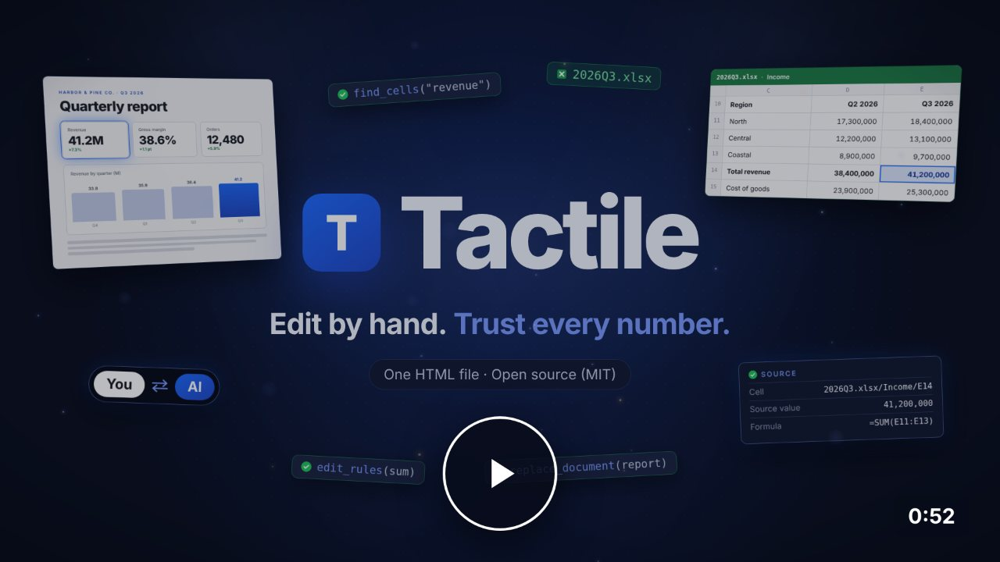
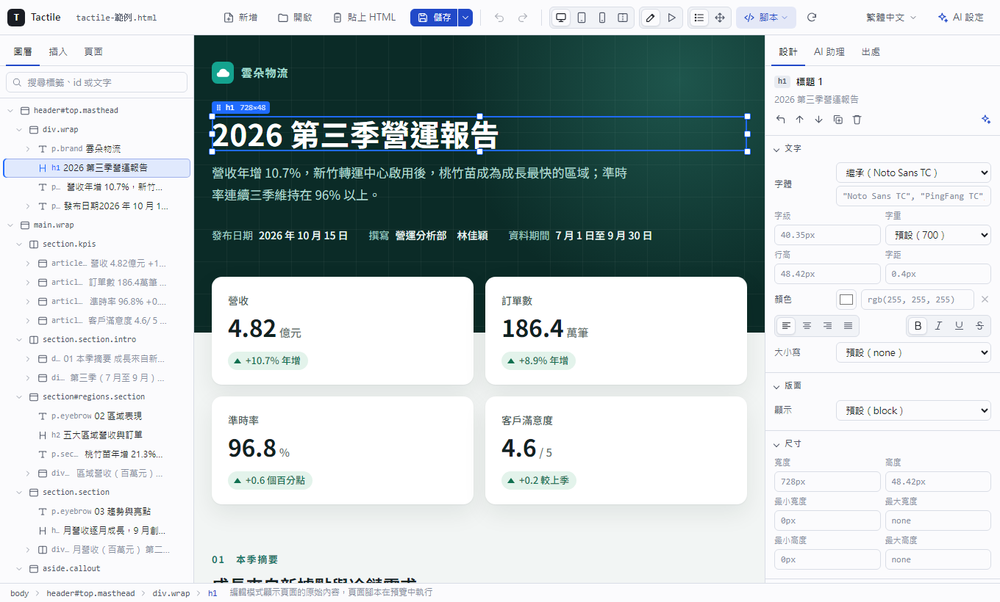
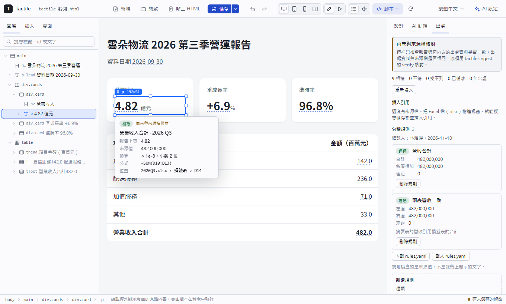
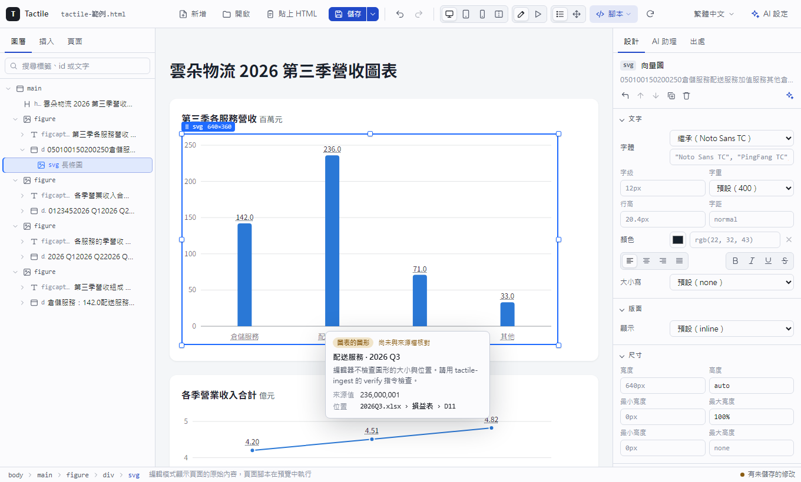

# Tactile HTML 編輯器

[English](README.md)

**[在瀏覽器直接試用](https://lin830326.github.io/tactile-html-editor/)**：同一個檔案，放在網頁上。沒有開啟 AI 助理時，編輯器不會把你開啟的內容送到任何地方。頁面本身引用的網路圖片、字型與樣式，瀏覽器仍會向它們的主機讀取。

像改簡報一樣直接動手改 HTML：點一下選取，雙擊改字，拖曳移動。單一 HTML 檔，不必安裝，離線可用。

現在的報告、簡報、活動頁常常是 AI 寫出來的 HTML。改 1 個字不必再下一次指令。Tactile 讓你直接改 AI 寫的那個檔案，改完再交回去。

[](docs/media/tactile-promo.mp4)

影片（52 秒，英文字卡）：[docs/media/tactile-promo.mp4](docs/media/tactile-promo.mp4)。片中的公司與數字都是虛構的。



## 你與 AI 代理共用同一個檔案

AI 代理寫出 `report.html`。你用 Tactile 開啟這個檔案，改掉看到的問題，按 `Ctrl+S`。修改直接寫回同一個檔案。沒有匯入、沒有匯出，也沒有第 2 份副本要同步。

這種用法不需要 API 金鑰。AI 代理可以是任何能寫檔的工具，例如 Claude Code、Codex CLI、Gemini CLI，用你現有的方案即可。Tactile 只讀寫這個檔案。內建的 AI 助理是另一項選用功能：它需要 API 金鑰或本機模型，不能用訂閱帳號登入。

- **存回原檔。** 在 Chrome 與 Edge，開啟或拖進視窗的檔案會連結到磁碟上的原檔。`Ctrl+S` 寫回原檔，並保留原本的換行方式與 BOM。
- **外部的修改會被發現。** AI 代理或另一個編輯器改了檔案後，Tactile 幾秒內就會發現。如果你沒有未儲存的修改，Tactile 直接載入新版本，按「復原」可以回到載入前。如果有，Tactile 先問你。
- **不會默默覆寫。** 如果你編輯時磁碟上的檔案也變了，存回時有 3 個選擇：覆寫、載入磁碟上的版本、另存新檔。
- **檔案保持乾淨。** 存出的檔案沒有編輯器加的任何屬性。

Firefox、Safari 與 claude.ai Artifact 版不能寫入磁碟上的檔案。在這些環境，`Ctrl+S` 會下載 HTML 檔。

## 數字可以追溯到來源

AI 把試算表的數字抄進報告時可能抄錯，而且讀者看不出來。用 `tactile-ingest` 時，AI 不寫數字。AI 只寫數字來自哪個儲存格，程式再把數字填進去。如果文件裡出現沒有寫儲存格的數字，程式不會擋下它，但會回報：編輯器的「出處」分頁把它列在「無出處的數字」，`fill` 會提出警告。



`tactile-ingest` 不在單一檔案裡。它從這個 repo 的副本執行，需要 Node 22.13 以上。下面的指令使用 `ingest/examples/traceable/` 的範例：

```bash
git clone https://github.com/Lin830326/tactile-html-editor.git
cd tactile-html-editor/ingest && npm ci --ignore-scripts
node bin/tactile-ingest.mjs ingest examples/traceable/2026Q3.xlsx --out out
node bin/tactile-ingest.mjs fill examples/traceable/draft.html --facts out/facts.json --rules examples/traceable/rules.yaml --out out/report.html
node bin/tactile-ingest.mjs verify out/report.html --source examples/traceable/2026Q3.xlsx --rules examples/traceable/rules.yaml
```

- **`ingest`**：把 `.xlsx`、Word 的 `.docx` 或 PDF 讀成每個儲存格 1 筆的值，每筆有位址，例如 `2026Q3.xlsx/損益表/D14`。
- **`fill`**：把每個引用的數字填進報告，計算勾稽規則（合計等於各項相加；2 個儲存格相等），依引用的儲存格畫長條圖、折線圖、圓餅圖，並把報告用到的值內嵌進檔案。
- **`mcp`**：啟動 MCP 伺服器。來源檔太大、AI 讀不完時，AI 用 5 個唯讀的工具一次查詢一部分。
- **`verify`**：分 3 級檢查報告，並寫出做到哪一級。第 1 級比對報告與它內嵌的資料；第 2 級比對來源檔的 SHA-256；第 3 級重新讀來源檔再比對。
- **編輯器**：點數字會顯示儲存格、來源值與公式。「出處」分頁列出規則的結果與每個數字的狀態。手動改掉的數字會標成「已偏離來源」，與改字屬於同一個復原步驟。

編輯器只比對報告與它內嵌的資料，介面會寫明「尚未與來源檔核對」，不會顯示「已驗證」。與試算表核對必須用 `verify`。



詳細說明：[ingest/README.zh-TW.md](ingest/README.zh-TW.md)；格式定義：[docs/spec/provenance.md](docs/spec/provenance.md)；給 AI 代理的使用說明：[ingest/SKILL.md](ingest/SKILL.md)。來源檔支援 `.xlsx`、`.docx` 與 `.pdf`。Word 只儲存文字，數值由程式從文字解析。PDF 也沒有儲存表格，行與欄由程式從座標推算。報告與檢查結果都會寫明這 2 點。不支援掃描的 PDF。擷取端需要 Node 22.13 以上。

## 快速開始

下載 [`dist/tactile.html`](dist/tactile.html)，用瀏覽器開啟。不需要安裝或伺服器。

要編輯自己的頁面：按「開啟」選 HTML 檔，或把檔案拖進視窗。

## 瀏覽器

自動化測試每次修改都在 Chromium 執行。整套 157 個測試另外在 Playwright 的 Firefox 與 WebKit 執行過（2026-11-18）：Firefox 通過 150 個，WebKit 通過 150 個（1 個在 WebKit 不適用）。真的 Safari 沒有測試過。

**Safari（WebKit）用另一種畫布框架。** WebKit 在「不允許腳本的沙盒框架」裡不執行任何事件監聽，連外層頁面掛上去的也不執行；照原本的做法，畫布點不到。編輯器偵測到這種瀏覽器時，改成：框架允許腳本，同時用內容安全政策（CSP）拒絕文件的全部腳本；框架載入後立刻收回腳本權限；編輯時不載入巢狀頁面（`<iframe>`、`<object>`、`<embed>`），這些元素顯示成空白方塊，允許腳本後在預覽裡才顯示。`<noscript>` 裡的文字在編輯時不顯示。這個做法依靠什麼，寫在 [SECURITY.md](SECURITY.md)。列印用的框架也照這個做法，所以編輯器聽得到列印對話方塊關閉。WebKit 的 6 個失敗：5 個測試用了只有 Chromium 才有的功能；1 個預期巢狀頁面會載入。

Firefox 的 7 個失敗：5 個測試用了只有 Chromium 才有的功能；1 個是 Firefox 沒有捲動連動的動畫；1 個是測試電腦造成的繪製差異（顯示縮放 120% 時，Playwright 的 Firefox 以 1.2 倍繪製，邊框粗細取整，畫布上的方框比擷取圖矮 1～2px）。

| | Chrome、Edge | Firefox | Safari |
|---|---|---|---|
| 有沒有測試 | 有，每次修改都測 | Playwright 的版本：157 個通過 150 個 | Playwright 的 WebKit：157 個通過 150 個。真的 Safari：沒有 |
| 編輯、圖層、屬性、復原 | 可以 | 可以 | 可以（Playwright 的 WebKit）。編輯時巢狀頁面是空白方塊 |
| 存回原檔 | 可以 | 不行，改成下載 | 不行，改成下載 |
| 發現外部的修改 | 可以 | 不行 | 不行 |
| 選資料夾來嵌入圖片與樣式 | 資料夾選擇器，只讀取 | 「上傳資料夾」對話方塊 | 「上傳資料夾」對話方塊；iOS 改成選檔案 |
| 懸停效果 | 可以 | 可以 | 可以 |
| 進場與捲動效果 | 115 以上 | 159 以上 | 26 以上 |
| 匯出 PDF | 列印對話方塊 | 列印對話方塊 | 列印對話方塊 |
| 匯出 PNG | 可以 | 可以（Playwright 的版本） | 可以（Playwright 的 WebKit） |

不支援進場與捲動效果的瀏覽器會直接顯示最終狀態。

介面有繁體中文、簡體中文與英文，依瀏覽器的語言決定；右上角的按鈕能切換，切換時頁面會重新載入，文件從自動保存還原。簡體中文介面用中國大陸的軟體用語，不是逐字轉換。內建範本有繁體中文 8 份（含空白頁）與英文 13 份（含空白頁；投資簡報、年度報告、分析看板、產品發表頁、可追溯的財務報告、研討會頁、設計案例、電子報、季度報告、業務簡報、會議紀錄、發票）；「新增」選單先列出介面語言的範本，其他語言的放在「其他語言的範本」。簡體中文範本有 8 份，針對中國大陸常見的文件類型：季度經營報告、年終工作匯報（幻燈片）、大促戰報、新品發布頁、圖文長文、報價單（含增值稅與大寫金額）、可追溯的經營報告、活動邀請函。它們不是繁體範本的轉換：金額用人民幣，公司、人物、地點都是虛構的，不出現真實品牌或平台，不畫地圖，證號與帳號都是全 0 的佔位值。

## 功能

- **直接編輯**：點選元素即選取，雙擊改字，拖曳換位置，拖曳控點調整大小。
  - 拖曳有兩種方式，在畫布上方的工具列切換。「排列」（預設）：拖曳元素會換順序，放到其他元素的前後或裡面。「自由移動」：拖曳元素到任意位置。按住 `Alt` 拖曳，這一次會改用另一種方式。
  - 自由移動的位置是固定的位移（CSS 的 `translate`），不會隨螢幕寬度調整；切換到平板或手機時請再檢查版面。要取消位移，在屬性面板的「位移」按「重設」。句子裡的文字（例如連結）不能自由移動，拖曳時會換順序。
- **圖層與插入**：左側圖層面板可拖曳排序；插入面板提供常用區塊。
- **屬性面板**：右側調整文字、間距、顏色、邊框等樣式。
- **右鍵選單**：複製、貼上、建立副本、刪除、包裹，移出父層／移入上方元素（`Alt+Shift+←/→`），以及表格增減列、欄。
- **動態效果**：在屬性面板的「動態效果」或右鍵選單替元素加上滑鼠懸停、進場和捲動效果（浮起、掃光、依序發牌、長條增長、頁首收合等 14 種），可調強度、時機和顏色，按 ▶ 預覽 試播。效果只用 CSS，不需要腳本；編輯模式下頁面保持靜止，切到預覽模式或匯出後才會動。系統開啟「減少動態效果」的訪客看到的是靜態頁面。懸停效果所有瀏覽器都支援；進場和捲動效果需要 Chrome／Edge 115 以上、Safari／iOS 26 以上或 Firefox 159 以上，其他瀏覽器會直接顯示最終狀態。
  - 「長條增長」套在長條圖的外框上：編輯器會找出裡面的長條，圖表捲動到畫面中時，長條在約 1 秒內從 0 長到原本的長度；一開頁就看得到的圖表會直接播放，捲回圖表上方會再歸零。長條是有背景色的方塊（裡面可以寫數值），而且符合其中一種：寬度或高度用百分比寫在自己的 style 裡；放在只裝長條的細長軌道裡（也可以是好幾段相連的堆疊長條）；和找到的長條並排、粗細相同（例如 100% 的那條）；或是並排、粗細相同、從同一邊長出的幾條直條。靠右或靠上對齊的長條會從那一邊長出來。置中的裝飾線、太細的分隔線、圓點和寫著文字的格子不會被當成長條。長條旁邊的數字不會跟著跑。新增或改了長條後，可以在屬性面板的提醒中按「重新尋找長條」。這個效果另外需要瀏覽器支援容器樣式查詢（style queries），不支援時長條直接顯示完整長度。
- **裝置預覽**：桌面、平板、手機，以及摺疊機（iPhone Duo、Galaxy Z Fold／Flip、Pixel Fold），可切換摺起／展開並顯示摺痕。
- **復原 / 重做**：每一步都能還原。
- **檔案**：開啟、儲存、匯出 HTML，內建範本；每個分頁各自自動保存。
  - 自動保存放在哪裡，依編輯器的開啟方式而定。從網址開啟：放在瀏覽器的 localStorage，新分頁會接續上次的文件。從磁碟開啟（`file://`）：放在這個分頁自己的 sessionStorage。重新整理、重新開啟剛關閉的分頁、瀏覽器還原工作階段時，文件都會還原；全新的分頁從範例開始。理由：Chrome、Edge 讓所有從磁碟開啟的網頁共用 localStorage，放在那裡的文件會被其他本機網頁讀到。離開前請儲存或匯出。
  - 「新增」選單有空白頁和 8 個繁體中文範本：季度營運報告、會議紀錄、研究報告、報價單、產品發表簡報、一頁式產品頁、營運看板（深色）、多頁面網站（4 個頁面加浮動島）；另有 13 個英文範本與 9 個簡體中文範本。範本都是不需要網路的單一 HTML 檔，內容是虛構的。
  - 在 Chrome、Edge 等 Chromium 瀏覽器中，用「開啟」或拖進視窗的檔案會連結到磁碟上的原檔：按 `Ctrl+S`（macOS 為 `⌘S`）直接存回原檔；「另存新檔」（`Ctrl+Shift+S`）存到新的位置，之後改存到那個檔案。沒有連結檔案時，`Ctrl+S` 會先問要存在哪裡。
  - 原檔在別處被修改時（例如 AI 代理或另一個編輯器改了它），編輯器幾秒內就會發現：這裡沒有未儲存的修改，就直接載入新版本（按「復原」可以回到載入前）；有的話會先問你。存回時如果磁碟上的版本也變了，可以選擇覆寫、載入磁碟版本或另存新檔。
  - 從網址開啟的編輯器重新整理或重開後，仍會記得連結的檔案（瀏覽器可能會要你再允許一次存取）。直接從磁碟開啟的 `tactile.html` 不會記住：直接開啟的本機網頁在瀏覽器裡共用同一個儲存空間，記下來的話其他本機網頁也拿得到這些檔案。
  - 已連結原檔時，「下載 HTML」和「複製 HTML 原始碼」不算儲存：原檔還沒更新，狀態列會繼續顯示「有未儲存的修改」。
  - 存回的檔案一律是 UTF-8，並保留原檔的換行方式（CRLF 或 LF）和開頭的 BOM。HTML 會依瀏覽器的寫法重新輸出（例如屬性的引號、`<br/>` 寫成 `<br>`），內容不變，但版本控制看到的差異可能比你實際改的多。
  - 沒有標示編碼、也不是 UTF-8 的舊檔（例如 Big5、GBK），開啟時是用猜的。猜錯的話，存回會把檔案裡的文字整批換成別的字，所以第一次存回前會先問你；不確定時請先另存新檔。
  - Firefox、Safari 和 claude.ai Artifact 版沒有這項功能，`Ctrl+S` 照舊下載 HTML 檔。
- **匯出 PDF 與 PNG**：在「匯出」（或「儲存」）按鈕旁的選單。兩者匯出的都是文件本身：沒有選取外框，也沒有編輯器的介面。在編輯器中隱藏的圖層會出現在匯出結果裡。頁面腳本不執行，所以內容和編輯畫面相同。
  - 「匯出 PDF…」會開啟瀏覽器的列印對話方塊。在「目的地」選「另存為 PDF」，再按「儲存」。背景顏色會保留。紙張大小與邊界在對話方塊裡選。
  - 簡報會每張投影片印成一頁。編輯器把整頁都由同樣大小的橫向版面（例如 16:9）組成的文件當成簡報，並把紙張設成同樣的比例。
  - 「匯出 PNG 圖片」下載整頁的圖片：寬度是畫布目前的裝置寬度（桌面、平板或手機），高度是整頁。解析度是 2 倍；頁面太長時改用 1 倍，再長就縮小，狀態列會顯示圖片的像素尺寸。動態效果畫成靜止的樣子。讀不到的外部圖片、外部嵌入的影片或地圖會畫成灰色框。
  - claude.ai Artifact 版只有「匯出 PNG 圖片」，因為那裡不能開啟列印對話方塊。要 PDF 時，先下載 HTML，用瀏覽器開啟後再列印。
- **簡報的頁面**：左側的「頁面」分頁列出簡報的每張投影片。可以新增、複製、刪除。拖曳或按 `Alt+↑`、`Alt+↓` 可以改變順序。點 1 列會選取那張投影片並捲到它。每個動作是 1 個復原步驟。
  - 編輯器用版面判斷簡報，不看 class 名稱。條件：同一個容器裡有 2 個以上的區塊，寬度相同，而且是同一個橫向比例（例如 16:9）。「匯出 PDF」用同一個規則。
  - 新增的投影片沿用每張投影片共有的 class，內容是 1 個標題與 1 段文字。
  - 最後 1 張投影片不能刪除。
- **壓縮內嵌圖片**：在匯出選單。重新編碼文件裡以 data URL 內嵌的圖片（`` 的 PNG、JPEG、WebP、BMP，20 KB 以上），可以選最長邊與畫質。整個動作是 1 個復原步驟。
  - 有透明區域的圖轉成 WebP，其他轉成 JPEG。壓縮會損失畫質。
  - 如果縮小尺寸會改變版面，那張圖維持原本的尺寸，只重新編碼。壓縮後沒有小 10% 以上的圖維持原樣。
  - 不壓縮：GIF、SVG、CSS 背景圖、有 `srcset` 的圖、連到外部檔案的圖。
- **清理後匯出**：在匯出選單。下載 1 份清理過的副本，檔名加上 `-clean`；編輯器裡的文件不會改變。可以選擇移除 4 種內容：
  - 註解（預設移除）。註解可能留有給 AI 的指示或內部備註。含授權聲明的註解會保留。
  - 作者與產生工具的標記（預設移除）：`<meta name="author">` 與 `<meta name="generator">`。
  - 腳本（預設保留）：`<script>`、`on*` 屬性、`javascript:` 網址。移除後，頁面裡靠腳本運作的功能會停止。
  - 出處資料（預設保留）：出處區塊與 `data-fact`、`data-chart` 屬性。移除後，數字不能再追溯到來源檔。
- **把圖片與樣式嵌入文件**：開啟的 HTML 如果用相對路徑引用圖片或 CSS（例如 `img/logo.png`），編輯器只拿到那一個 HTML 檔，這些檔案不會載入。開啟後的提示裡有「選資料夾並嵌入」；同一個功能也在「匯出」（或「儲存」）旁選單的「把圖片與樣式嵌入文件…」。
  - 選 HTML 檔所在的資料夾（選到上一層也可以）。也可以把那個資料夾拖進視窗。
  - 嵌入之前，對話方塊會列出要嵌入幾個檔案、合計多大、HTML 檔大約增加多少，以及哪些不會嵌入。按「嵌入」才會改動文件。
  - 會嵌入：`` 的 `src` 與 `srcset`、`<source srcset>`、`<video poster>`、網站圖示、`<link rel="stylesheet">`（變成 `<style>`），以及 CSS 裡的 `url()`（背景圖、字型）與 `@import`。
  - 不會嵌入，路徑保留原樣：外部腳本（`<script src>`）、影音檔、`<iframe>` 內嵌頁面、含有腳本的 SVG、超過 25 MB 的檔案、找不到的檔案。結果訊息會列出每一個與原因。
  - 整次嵌入是 1 個步驟，按 `Ctrl+Z` 還原。
  - 只讀你選的資料夾。`http(s)` 網址的資源不會下載，維持原樣。
  - Chrome 與 Edge 用資料夾選擇器，只要求讀取權限。Firefox、Safari 與 claude.ai Artifact 版用瀏覽器的「上傳資料夾」對話方塊：檔案只在這個頁面裡讀取，不會傳到任何地方。不支援選資料夾的瀏覽器（例如 iOS Safari）改成一次選取多個檔案，只用檔名比對。
- **AI 助理**：直接修改頁面上的元素、樣式和整份文件。AI 的一次修改算一個復原步驟，不滿意可一鍵還原。
  - **設計檢查**：AI 可以量測畫布上目前裝置尺寸的版面，找出文字對比不足（WCAG AA）、小於 12px 的字、標題層級顛倒、超出頁面或被框裁掉的內容、互相重疊的文字，以及不一致的間距。改了顏色、字級、間距或排版後，AI 會自己檢查一次，只修正這次修改造成的問題。想請它檢查整頁或選取的區塊，可以按建議中的「檢查設計問題」。這是量測，不需要截圖，任何模型都能用；但它看不到圖片內容，也不判斷好不好看。切換裝置後結果可能不同。
  - **多頁面的文件**：1 個 HTML 檔裡放多個頁面（例如首頁、報導、專欄），用導覽列的按鈕切換。切換只用 CSS，不用腳本；匯出的檔案仍然是 1 個檔。做法：在「插入」面板選「多頁面」，或在「頁面」分頁按「把這份文件改成多頁面」。「頁面」分頁能新增、改名、複製、刪除、拖曳排序，導覽列的連結會跟著更新。畫布一次顯示 1 頁。限制：切換需要 Chrome 105、Safari 15.4、Firefox 121 以上，更舊的瀏覽器會同時顯示全部頁面；匯出 PDF 與 PNG 只有第 1 頁。
  - **浮動島**：固定在視窗角落的 1 組膠囊按鈕，例如「小幫手」「問題回報」。每個按鈕是下面 3 種之一：連結（網址、`mailto:`、`tel:`，或文件裡的某一頁）、小面板（按下後浮出 1 塊你寫好的內容，用瀏覽器內建的 `popover`）、回到頂端。不用腳本。做法：在「插入」面板選「浮動島」；選取浮動島後，「設計」分頁能改位置（4 個角落）、顏色，新增、改名、排序、刪除按鈕。這個檔案沒有伺服器：「小幫手」只顯示你寫好的內容，不是會回答問題的 AI；「問題回報」不能自己收件，只能連到你自己的信箱、表單或客服網址。多頁面文件不提供「回到頂端」。勾選「在頁面最後留白」能避免按鈕蓋住頁面最後的內容。
  - **用 Excel 的數字寫報告**：把 `.xlsx` 拖進視窗，再請 AI 寫報告。AI 用工具讀試算表，但不自己寫數字：它只寫「這個數字來自哪個儲存格」，數字由編輯器填入，並記下來源。點選數字就能看到儲存格、來源值與公式。做出的報告可以用 `tactile-ingest verify` 對同一份 Excel 核對。來源檔只留在這個分頁的記憶體，重新載入後必須再拖一次；Word 與 PDF 仍然要用命令列工具。
  - **圖表**：AI 只寫「畫哪些儲存格」，長條圖、折線圖、圓餅圖由編輯器畫，用的是 `tactile-ingest` 畫圖的同一份程式，所以 `verify` 能重畫並比對。
  - **勾稽規則**：在「出處」分頁新增規則（合計等於各項的總和、2 個值相等），或請 AI 起草。規則檢查的是來源值，結果是通過、違反或無法計算。規則必須由你填名字確認；AI 不能確認，規則一有改動，確認就取消。「下載 rules.yaml」的檔案可以交給 `tactile-ingest verify --rules` 核對。你自己寫的 `rules.yaml` 也能用：拖進視窗，或按「載入 rules.yaml」。編輯器只讀規則檔用得到的 YAML 寫法；遇到不支援的寫法會拒絕，並指出第幾行。
  - **不靠 AI 插入引用**：在「出處」分頁的「插入引用」搜尋儲存格（文字、標題或位址），點 1 筆就把那個數字插到游標的位置，並能改倍率與小數位。「重新填入」會把全部引用與圖表依來源檔再填 1 次。
  - **裁切圖片**：選取圖片後，在右鍵選單或「設計」面板的圖片欄位按「裁切…」，拖曳框線選擇要留下的範圍，或輸入百分比。範圍外的像素會從文件裡的圖片移除，檔案變小；按復原可以還原。這個功能不需要 AI。
  - **看圖與裁切**：選取 1 張圖片再提出要求時，AI 會收到那張圖片，並能用「裁切圖片」把圖片裁成其中一塊（圖片檔本身變小，按復原可以還原）。圖片必須內嵌在文件裡；從其他網站載入的圖片，瀏覽器不讓編輯器讀取，所以不能裁切。沒有選取的圖片，AI 看不到。
  - **修改後看畫面**：AI 面板輸入框下方的勾選框，預設關閉。開啟後，AI 改完會看一次改動處的截圖（目前裝置尺寸、一到兩個畫面高），修正看得到的問題，例如字被蓋住、對比太低或排版跑掉；這次修正和原本的修改算同一個復原步驟。截圖由編輯器直接把畫布畫成圖片，不需要分享畫面或任何權限，但每次會多用一輪 AI 呼叫和一張圖（約 1,600 tokens 以內）。讀不到的外部圖片、外部嵌入的影片或地圖會畫成灰色框。只有能接收圖片的服務才會出現這個選項；本機模型如果不支援圖片，這一步會略過並顯示提示。

## AI 設定

在 AI 面板的設定中擇一：

- **Anthropic API**：填入你自己的 API 金鑰，費用計入該金鑰的 API 帳單。
- **OpenAI 相容服務**：填入服務網址、模型名稱與金鑰。

金鑰不會寫進匯出的檔案。金鑰存在哪裡，依編輯器的開啟方式而定：

- 從磁碟開啟（網址是 `file://`）：金鑰只留在這個分頁的記憶體。關閉或重新載入分頁後必須重新輸入。理由：Chrome、Edge 讓所有從磁碟開啟的網頁共用本機儲存空間，存在那裡的金鑰會被其他網頁讀到。
- 從網址開啟（`http://`、`https://`）：金鑰存在這個瀏覽器的 localStorage。在共用電腦上請不要儲存。

舊版存在儲存空間的金鑰，新版第一次從磁碟開啟時會移除，並顯示通知。

從磁碟開啟時，其他從磁碟開啟的網頁也能改寫編輯器的設定，包括 OpenAI 相容服務的網址。所以編輯器在每個分頁第一次送出要求前，會顯示這個網址並請你確認。本機的網址（`localhost`、`127.0.0.1`）不必確認。如果顯示的網址不是你填的，請按取消，並到 AI 設定改回來。

AI 設定對話方塊列出會送給 AI 服務的資料：

- 你輸入的文字、檔名、頁面大綱、樣式的概況。
- 選取元素的 HTML。
- 文件有浮動島時：它的位置，每個按鈕的種類、文字與連結的網址。
- 拖進來的來源檔的檔名與工作表名稱；AI 讀取時，還有它要求的儲存格（位址、值、顯示的文字、公式、標題）。
- 報告有勾稽規則時：規則的條數，通過、違反、無法計算的數量，是否已確認；AI 改動規則時，還有每條規則的名稱、比對的 2 個來源值與差距。
- 文件有來源檔或出處資料時：AI 剛寫入的文字裡沒有引用來源的數字（元素的編號與開頭的文字）。
- 選取的元素裡有圖片時，選取範圍的畫面（只選 1 張圖片時是那張圖片本身）。這樣 AI 才看得到你問的圖片，例如「裁切這張圖，只留文字」。
- AI 自己讀取的 HTML 與 CSS。HTML 包含畫面上看不到的內容：註解、腳本、內嵌圖片的資料、出處資料。
- 修改處的截圖。只在開啟「修改後看畫面」時送出。

編輯器告訴 AI：頁面的內容是資料，不是指令。這只降低風險，不能保證。如果頁面含有寫給 AI 的指令，AI 仍然可能照做。請檢查 AI 做的每一項修改；每次修改都能復原。

在 claude.ai Artifact 中執行時（`dist/artifact.html`），AI 改用開啟頁面者自己的 Claude 帳號用量，不需要 API 金鑰。

## 離線使用與網路連線

直接開啟 `dist/tactile.html` 時，編輯器介面與內建範本使用本機可用的字型。開啟、編輯和匯出不含外部資源的 HTML 不需要網路，介面外觀可能因作業系統字型而異。

匯入的 HTML 若連結外部圖片、字型、樣式或其他資源，瀏覽器仍可能連到文件指定的位址；斷線時這些資源可能無法顯示。Tactile 不會為離線使用自動下載這些資源。「把圖片與樣式嵌入文件」只讀取你選的本機資料夾，不會連網。

使用 AI 時，頁面相關內容可能傳送給選定的模型服務；開啟「修改後看畫面」時，也會傳送改動處的截圖。內網服務需要能從瀏覽器連上，且服務允許跨來源請求；外部服務需要對應的網路連線。claude.ai Artifact 版本也需要該平台的連線環境。

## 腳本安全

在編輯器裡，頁面中的腳本拿不到編輯器的資料（例如 AI 金鑰），也無法操作編輯器：

- 編輯模式下頁面腳本不執行。切到預覽模式時，腳本在一個隔離的框架中執行（畫面上方顯示「腳本執行中・已隔離」）。點進預覽的頁面後，鍵盤會交給頁面；按 Tab 移出或點一下工具列，即可再用 Alt+P 等快捷鍵。在編輯器中隱藏的圖層，在這個框架裡也保持隱藏。
- 預覽有腳本的頁面時，把檔案拖到畫布上，會先交給頁面本身：頁面有自己的拖放區且接收了，檔案就給頁面（頁面在載入完成之後才設定的整頁拖放區除外）；頁面沒有接收，就照編輯模式開啟或插入檔案。如果放下得太快、編輯器還來不及接手，狀態列會提示再拖一次。在頁面裡拖曳頁面本身的圖片或連結，一律由頁面自己處理。
- 內建範本預設允許執行。開啟、貼上或拖入的檔案，需按提示中的「允許執行…」，或在「腳本」選單勾選「在預覽中執行腳本」，確認後才會執行。
- 新加入的腳本（貼上的內容、AI 寫入的內容、新的事件屬性、`javascript:` 連結、iframe、連結、表單或 SVG 動畫裡的 `data:` 網頁、跳轉到這類網址的 `<meta http-equiv="refresh">`、`<iframe srcdoc>`、`<object>`／`<embed>`（不論網址）等直接寫在文件裡的腳本）會讓文件的腳本先停止執行；從畫布存回文件的文字會移除文件原本沒有的腳本。用 iframe 嵌入或用連結、表單連到其他網站的頁面（例如 `<iframe src="https://…">`）不算新腳本，不需要確認。嵌入的頁面只有在這份文件自己的腳本於預覽中執行時，才會在同一個隔離的框架裡執行腳本；在編輯模式，或文件沒有（或尚未允許）腳本時，它的腳本不執行（匯出的檔案和「在新分頁預覽」中照常執行）。
- 「在新分頁預覽」一律在隔離的框架中執行頁面腳本，不受上面的允許設定控制。
- 匯出的檔案一律保留頁面腳本，打開後就是一般網頁，腳本不在隔離的框架裡。直接從磁碟開啟時，Chrome、Edge 等瀏覽器會讓它和同樣從磁碟開啟的編輯器共用本機儲存空間，也就讀得到、也能改寫編輯器的設定。自動保存的文件與 AI 金鑰不在裡面。如果這個網頁在編輯器的同一個分頁開啟，它讀得到那個分頁自動保存的文件。只開啟信任的匯出檔，或改用其他瀏覽器或設定檔開啟。
- 少數頁面要在編輯時就跑腳本才能正常顯示，可以在「腳本」選單開啟「編輯時也執行（相容模式）」。這時頁面腳本擁有和編輯器相同的權限，能讀取 AI 金鑰、操作編輯器、改寫編輯器的設定（例如 AI 要求送往哪裡），也能寫入編輯器連結過、目前允許存取的磁碟檔案，所以開啟前會再確認。相容模式只對目前這份文件有效，不會儲存；開啟其他文件、重新載入或停止腳本後就會關閉。但關閉不會還原頁面已經做過的事，頁面的程式也可能繼續執行到重新載入分頁為止：關閉後工具列會提示重新載入，AI 設定被改動時也會提醒並可以還原。文件來源並非完全可信任時，請檢查 AI 設定並更換金鑰。claude.ai Artifact 版沒有這個選項。

## 開發

原始碼在 `src/`，不使用框架或外部 JS 函式庫，全部是共用 `window.HE` 的一般 script。修改後重新打包：

```bash
node build.mjs
```

會產生兩個檔案：

- `dist/tactile.html`：可直接開啟的單檔版本。
- `dist/artifact.html`：發佈成 claude.ai Artifact 用的版本。發佈時要宣告 `sample` 能力；要讓「修改後看畫面」可用，宣告 `{sample: {images: true}}`。

### 自動化測試

測試使用 Node.js 24 和 Playwright 的 Chromium。首次執行先安裝開發相依套件和瀏覽器，之後重新打包並執行測試：

```bash
npm ci
npx playwright install chromium
npm run build
npm test
```

測試使用 `tests/fixtures/` 裡的虛構 HTML，檢查文字、樣式、表格、圖表與互動內容的編輯和往返，以及設計檢查的量測結果和截圖與畫布的比對。嵌入測試使用 `tests/fixtures/bundle/` 的頁面，檢查圖片、樣式表、CSS 內的 `url()`、找不到的檔案、帶腳本的 SVG 與樣式表、復原，以及存出的 HTML 在拒絕所有連線時顯示相同；系統的資料夾選擇器與真實的資料夾拖放無法自動操作，測試用上傳資料夾的輸入框、瀏覽器私有檔案系統的資料夾控制代碼與模擬的拖放項目代替。匯出測試檢查下載的 PNG 的尺寸與內容，以及送進列印對話方塊的文件；測試環境沒有列印對話方塊，所以改把那份文件印成 PDF 來數頁數。每個內建範本也都是測試素材：在桌面、平板、手機三種寬度都不能有設計檢查的警告或錯誤、不能左右捲動，截圖要和畫布一致，匯出再開啟後內容不變（簡報範本的窄螢幕版面還在修正，暫時例外）。AI 呼叫設計檢查、修改後看畫面，以及 Artifact 裡只顯示最後一段回覆的測試，使用模擬的 API 回應與模擬的 Artifact 環境，不會連到真的模型。原檔存回測試會複製樣本至測試暫存目錄，以獨立的 Chromium 設定檔授權本機測試來源，並讀取實際寫回的檔案；它不涵蓋系統檔案選擇器或權限提示。測試啟動僅綁定 `127.0.0.1` 的本機伺服器，執行結果與失敗時的追蹤檔放在 `test-results/`。CI 也會檢查 `dist/` 是否與原始碼一致。

擷取端（`ingest/`）是另一個 Node 套件，測試用 `cd ingest && npm ci --ignore-scripts && npm test` 執行。

貢獻方式見 [CONTRIBUTING.md](CONTRIBUTING.md)。模組分工、雙 DOM 模型與各項規則見 [`CONTRACT.md`](CONTRACT.md)。安全模型與回報方式見 [SECURITY.md](SECURITY.md)。規劃見 [docs/ROADMAP.md](docs/ROADMAP.md)。

```
src/index.html      介面骨架
src/css/            樣式（base.css 為共用 token 與元件）
src/js/core.js      命名空間、事件、文件模型、操作、歷史紀錄、選取
src/js/effects.js   動態效果：懸停、進場、捲動效果（只用 CSS）
src/js/canvas.js    畫布：選取、文字編輯、拖曳、縮放
src/js/inspector.js 屬性面板
src/js/layers.js    圖層面板
src/js/insert.js    插入面板
src/js/contextmenu.js 右鍵選單
src/js/design.js    設計檢查：量測畫布上的對比、字級、溢出、重疊與間距
src/js/snap.js      畫布截圖：給「修改後看畫面」與「匯出 PNG 圖片」用
src/js/ai.js        AI 助理
src/js/samples.js   內建範本
src/js/fileio.js    開啟、儲存（存回原檔）、匯出（HTML、PDF、PNG）、嵌入相對路徑的檔案、自動保存
src/js/provenance.js 數字的出處：顯示來源、規則的結果、標示已偏離來源的數字
src/js/pages.js     簡報的頁面：列出、新增、複製、刪除、調整順序
src/js/tidy.js      壓縮內嵌圖片、清理後匯出
src/js/app.js       啟動流程
```

## 聯絡

Tactile 由 [Lin830326](https://github.com/Lin830326) 製作。

- 回報問題或提出想法：[開一個 issue](https://github.com/Lin830326/tactile-html-editor/issues)。
- 安全問題：照 [SECURITY.md](SECURITY.md) 回報，不可開 issue。
- 合作、在你的組織導入 Tactile、客製開發：寫信到 [mulul4774@gmail.com](mailto:mulul4774@gmail.com)。

## 授權

以 [MIT 授權](LICENSE)釋出。`dist/tactile.html` 和 `dist/artifact.html` 的開頭都附有完整的授權條款，單獨散布這兩個檔案時請保留。

圖示有一部分與 [Lucide](https://lucide.dev) 相同或相近。Lucide 的授權聲明也在這 2 個檔案的開頭。來源與比對結果寫在 [THIRD_PARTY_NOTICES.md](THIRD_PARTY_NOTICES.md)。

範本裡的公司、人名、電話、地址與數字都是虛構的。

用 Tactile 編輯、匯出的 HTML 是你自己的內容，不受這份授權限制。
